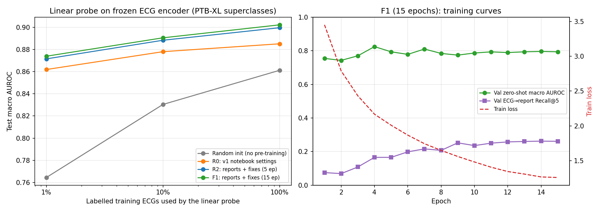
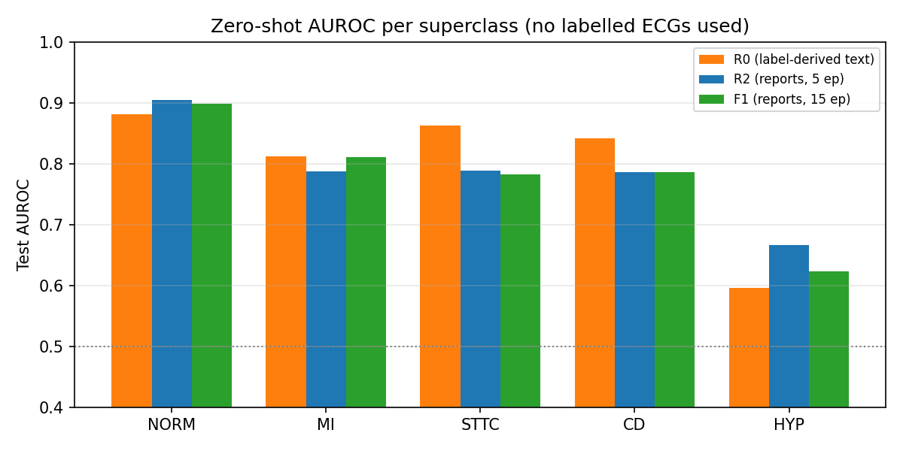

# ECG ↔ Text Contrastive Learning on PTB-XL

A CLIP-style multimodal model that aligns **12-lead ECG signals** with **clinical text** (cardiologist reports),
so that ECGs can be classified from plain-English descriptions (zero-shot), retrieved by text query, and used as
pre-trained features for label-efficient downstream classification.

- **ECG encoder**: ECG-FM-style CNN feature extractor + 12-layer Transformer (86 M params, trained from scratch).
- **Text encoder**: [Bio_ClinicalBERT](https://huggingface.co/emilyalsentzer/Bio_ClinicalBERT) (108 M params, fine-tuned).
- **Objective**: symmetric InfoNCE with a learnable temperature in a shared 512-d space (multi-positive variant for identical reports).
- **Data**: [PTB-XL 1.0.3](https://physionet.org/content/ptb-xl/1.0.3/) — 21,799 ECGs (500 Hz, 10 s), official folds (1–8 train / 9 val / 10 test).
- **Text supervision**: the cardiologists' free-text reports, cleaned and translated to English (they are 67 % German, 3 % Swedish) — see [`data/`](data).

## Headline results (PTB-XL test fold, macro AUROC over the 5 diagnostic superclasses)

| Model | Zero-shot (no labelled ECGs) | Linear probe, 1 % labels | 10 % | 100 % |
|---|---|---|---|---|
| Untrained encoder (baseline) | 0.516 | 0.764 | 0.830 | 0.861 |
| **This work, 15 epochs** | **0.814**¹ | **0.874** | **0.890** | **0.902** |

¹ checkpoint selected on validation zero-shot AUROC; last-epoch checkpoint: 0.780.

- Pre-training helps most when labels are scarce: **+0.11 AUROC with 1 % of the labels** (~170 ECGs).
- The model is trained on free-text reports, not on text generated from the labels, so the zero-shot number is not inflated by label leakage.
- Full ablations, run-to-run noise, the zero-shot prompt study and all caveats: **[`results/RESULTS.md`](results/RESULTS.md)**.




## Pipeline

```
12-lead ECG, 500 Hz, 10 s ─► z-score per lead ─► random 5-s crop (train) / mean of both 5-s windows (eval)
        │
        ▼
  CNN (4 blocks, 256 ch) ─► 12-layer Transformer (768-d, conv. relative positions) ─► mean-pool ─► MLP ─► L2 ─┐
                                                                                                           ├─► InfoNCE (τ learnable)
  Report text ─► Bio_ClinicalBERT ─► [CLS] ─► MLP ─► L2 ─────────────────────────────────────────────────────┘

Evaluation
  zero-shot     cos(ECG, text of each superclass' SCP statements), max over statements → macro AUROC
  linear probe  frozen 768-d ECG features + logistic regression, 1 % / 10 % / 100 % of training labels
  retrieval     ECG → its own report among all unique reports (Recall@1/5)
```

## Repository layout

| Path | Contents |
|---|---|
| [`notebooks/ECG_Multimodal.ipynb`](notebooks/ECG_Multimodal.ipynb) | **Main pipeline** (Colab / lab GPU): data, labels, text, signal cache, model, training, zero-shot, linear probe (+ random-init baseline), t-SNE, retrieval |
| [`notebooks/Pretrain_CMSC.ipynb`](notebooks/Pretrain_CMSC.ipynb) | ECG-only contrastive pre-training (CMSC); its checkpoint can warm-start the ECG encoder (`ECG_PRETRAINED`) |
| [`src/ecgclip.py`](src/ecgclip.py) | Script version used for every experiment in `results/` (same model code / state-dict keys as the notebook) |
| [`src/experiments.txt`](src/experiments.txt) | Exact command-line arguments of every run |
| [`src/translate_reports.py`](src/translate_reports.py) | Report cleaning + German cardiology glossary + MarianMT translation |
| [`src/posthoc_eval.py`](src/posthoc_eval.py), [`src/summarize.py`](src/summarize.py), [`src/make_figures.py`](src/make_figures.py) | Prompt study, results table, figures |
| [`src/download_ptbxl.py`](src/download_ptbxl.py) | Parallel download of PTB-XL (500 Hz records) from PhysioNet's AWS open-data mirror |
| [`data/ptbxl_reports_en.csv`](data/ptbxl_reports_en.csv) | English translation of every PTB-XL report |
| [`results/`](results) | Write-up, figures, per-run logs (`results.jsonl` = every evaluation, `log.txt` = training log) |

## Quick start

```bash
pip install -r requirements.txt
python src/download_ptbxl.py            # or download the zip from PhysioNet into data/
```

**Notebook (Colab or lab GPU)**: open `notebooks/ECG_Multimodal.ipynb`, set `PTB_DIR`, `SAVE_DIR`, `CACHE_DIR`
and `REPORTS_EN_CSV` in the configuration cell, run all. Defaults are the best configuration found
(reports as text, 15 epochs, LR 1e-4 ECG / 2e-5 BERT / 2e-4 heads / 1e-3 temperature, batch 64, bf16).
On GPUs with < 12 GB set `GRAD_CKPT = True`.

**Scripts** (paths configurable through `PTB_DIR`, `REPORTS_EN_CSV`, `ECG_CACHE`, `RUNS_DIR`):

```bash
python src/ecgclip.py cache                                    # build the 2.6 GB signal cache once
python src/ecgclip.py train --name F1_report_15ep --text report --multipos 1 \
    --lr_ecg 1e-4 --lr_text 2e-5 --lr_proj 2e-4 --lr_temp 1e-3 --epochs 15 --ckpt 1 --full_every 5
```

Hardware used for `results/`: one RTX 3060 Laptop GPU (6 GB), bf16 + gradient checkpointing, ≈ 6 min / epoch.

## Data and licences

- PTB-XL is © its authors, released under **CC BY 4.0** by PhysioNet. `data/ptbxl_reports_en.csv` is a derived work
  (cleaned + machine-translated `report` field) and is shared under the same licence. Please cite:
  Wagner, P. et al. *PTB-XL, a large publicly available electrocardiography dataset.* Scientific Data 7, 154 (2020);
  and Goldberger, A. et al. *PhysioBank, PhysioToolkit, and PhysioNet.* Circulation 101(23) (2000).
- Machine translations contain some errors (documented in `results/RESULTS.md` §5); they are not clinical-grade.

## References

- McKeen, K. et al. *ECG-FM: An Open Electrocardiogram Foundation Model.* arXiv:2408.05178 (2024) — ECG encoder architecture and CMSC pre-training.
- Yang, K. et al. *ECG-LM: Understanding Electrocardiogram with a Large Language Model.* Health Data Science (2025), doi:10.34133/hds.0221.
- Radford, A. et al. *Learning Transferable Visual Models From Natural Language Supervision (CLIP).* ICML 2021.
- Alsentzer, E. et al. *Publicly Available Clinical BERT Embeddings.* Clinical NLP Workshop 2019.
